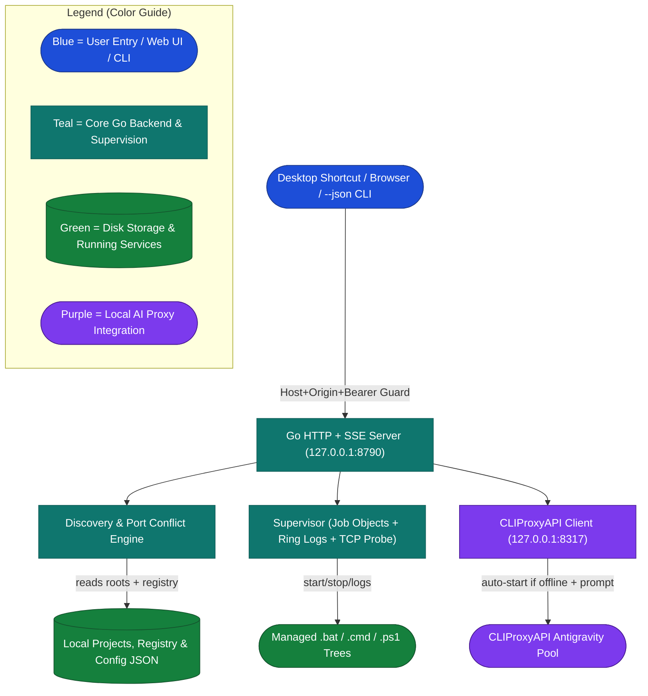
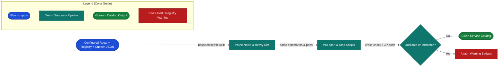
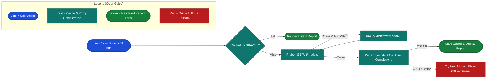

# System Architecture & Visual Flows (`ARCHITECTURE.md`)
> **1-Line Summary:** Living visual architecture of `Server Manager`, covering its pure-Go core, multi-root script discovery, Windows Job Object supervision, CLIProxyAPI AI integration, and embedded Material 3 Web UI.

## 1. High-Level Visual System Map
* **Plain-English Overview:** `ServerManager.exe` runs a loopback-only Go HTTP server (`127.0.0.1:8790`) plus a lightweight Windows System Tray icon, serving an embedded Material 3 web dashboard. The backend scans configured project folders and `ecosystem-registry.json`, tracks live ports and child process trees, and connects to local `CLIProxyAPI` (`127.0.0.1:8317`) on demand for plain-English script reports and AI-assisted project onboarding.

## 2. Tech Stack & Why We Chose It

| Layer | Tool / Library | Plain-English Reason Why |
| --- | --- | --- |
| Core & Tray | Go 1.24+ & `golang.org/x/sys/windows` | Compiles to a single fast portable `.exe` with zero CGO, reliable Windows Job Objects, and native Win32 System Tray. |
| Frontend | Embedded HTML5 + Material 3 CSS + ES Modules | Zero `node_modules` bloat; loads shared `m3-tokens` from `SharedLibraries` with built-in offline fallbacks. |
| AI Bridge | `CLIProxyAPI` HTTP `/v1` (`127.0.0.1:8317`) | Reuses your configured Antigravity accounts locally without bundling API keys or extra SDKs. |
| Persistence | UTF-8 No-BOM Atomic JSON (`%LOCALAPPDATA%\ServerManager\`) | Human-inspectable, crash-safe atomic writes for settings, custom projects, stacks, and cached AI reports. |

## 3. Core Subsystems & Visual Feature Flows

### [SUBSYSTEM: Script-Discovery-And-Conflict-Engine] | Aliases: scanner, parser, port conflicts, registry mismatch
> **1-Line Summary:** Walks bounded scan roots, merges `ecosystem-registry.json`, pairs `start`/`stop` scripts, parses commands/ports statically, and flags port collisions.
* **Plain-English Walkthrough:** Discovery iterates over user-configured roots up to depth 3 while immediately pruning `node_modules`, `.venv`, `.git`, and heavy media trees. Each `.bat`/`.cmd`/`.ps1` file is parsed for commands, ports, and URLs, grouped with any sibling `stop*` script in the same project, merged with custom catalog entries and `ecosystem-registry.json`, and scanned for duplicate ports or registry mismatches.

* **Code Anchors (Grep Targets):**
  * `internal/discovery/scanner.go` -> `Scan`
  * `internal/discovery/conflicts.go` -> `DetectConflicts`

### [FLOW: Options-AI-Report-And-Add-Project] | Aliases: ai report, cli proxy, add with ai, auto-start
> **1-Line Summary:** Clicking Options or Add with AI checks `127.0.0.1:8317`, auto-starts `CLIProxyAPI` if offline, queries an available model with redacted context, and caches or pre-fills the result.
* **Plain-English Walkthrough:** When the user opens Options on a script, the backend first checks whether a SHA-256 cached AI report exists. On a cache miss (or Refresh), it probes `127.0.0.1:8317/v1/models`, silently launches `~/.cli-proxy-api/start-cliproxy-hidden.vbs` if offline and auto-start is enabled, sends redacted script/project metadata to the first healthy model (falling back across models on HTTP 429 quota cooldowns), and persists the structured plain-English report.

* **Code Anchors (Grep Targets):**
  * `internal/aiproxy/client.go` -> `EnsureRunning`, `GenerateReport`, `AnalyzeProjectFolder`
  * `internal/server/server.go` -> `handleServiceAIReport`, `handleAIAnalyzeProject`

### [FLOW: Supervised-Start-Stop-And-Port-Probe] | Aliases: start server, stop server, job object, taskkill, live logs
> **1-Line Summary:** Spawns `.bat`/`.ps1` processes inside a tracked Windows Job Object, captures live stdout/stderr, and stops trees cleanly via paired stop scripts plus process-tree termination.
* **Plain-English Walkthrough:** Starting a service executes its command with non-blocking stdin (so trailing `pause` lines never freeze shutdown), assigns the PID to a Windows Job Object, and streams stdout/stderr lines into a 500-line ring buffer broadcast over SSE. Stopping runs any paired `stop*` script first when applicable, kills the spawned process tree cleanly, and verifies the TCP port closes.

* **Code Anchors (Grep Targets):**
  * `internal/supervisor/manager.go` -> `Start`, `Stop`, `RefreshPorts`
  * `internal/security/job_windows.go` -> `JobSupervisor`

## 4. Recipes: How to Add New Things Safely
* **To add a new scan root or custom service:**
  1. Use `+ Add Project` (with optional `Analyze with AI`) in the Web UI, or edit `config.json` -> `scanRoots` / `customServices` under `%LOCALAPPDATA%\ServerManager\`.
* **To add a new API endpoint or CLI verb:**
  1. Register route with `d.withGuard(...)` in `internal/server/server.go` -> `Handler`.
  2. Add corresponding subcommand in `internal/cli/cli.go` -> `Run` emitting clean JSON under `--json`.
