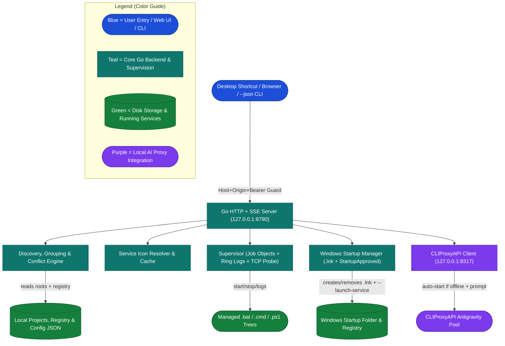
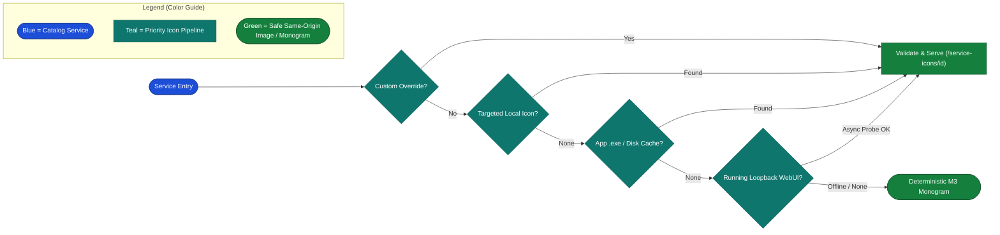
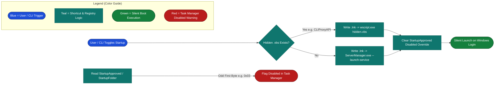

# System Architecture & Visual Flows (`ARCHITECTURE.md`)
> **1-Line Summary:** Living visual architecture of `Server Manager`, covering its pure-Go core, multi-root script discovery, Windows Job Object supervision, CLIProxyAPI AI integration, and embedded Material 3 Web UI.

## 1. High-Level Visual System Map
* **Plain-English Overview:** `ServerManager.exe` runs a loopback-only Go HTTP server (`127.0.0.1:8790`) plus a lightweight Windows System Tray icon, serving an embedded Material 3 web dashboard. The backend scans configured project folders and `ecosystem-registry.json`, tracks live ports and child process trees, and connects to local `CLIProxyAPI` (`127.0.0.1:8317`) on demand for plain-English script reports and AI-assisted project onboarding.

## 2. Tech Stack & Why We Chose It

| Layer | Tool / Library | Plain-English Reason Why |
| --- | --- | --- |
| Core & Tray | Go 1.24+ & `golang.org/x/sys/windows` | Compiles to a single fast portable `.exe` with zero CGO, reliable Windows Job Objects, and native Win32 System Tray. |
| Frontend | Embedded HTML5 + Material 3 CSS + ES Modules | Zero `node_modules` bloat; loads shared `m3-tokens` from `SharedLibraries` with built-in offline fallbacks. |
| AI Bridge | `CLIProxyAPI` HTTP `/v1` (`127.0.0.1:8317`) | Reuses your configured Antigravity accounts locally without bundling API keys or extra SDKs. |
| Persistence | UTF-8 No-BOM Atomic JSON (`%LOCALAPPDATA%\ServerManager\`) | Human-inspectable, crash-safe atomic writes for settings, custom projects, stacks, and cached AI reports. |

## 3. Core Subsystems & Visual Feature Flows

### [SUBSYSTEM: Script-Discovery-And-Conflict-Engine] | Aliases: scanner, parser, port conflicts, registry mismatch
> **1-Line Summary:** Walks bounded scan roots, merges `ecosystem-registry.json`, pairs `start`/`stop` scripts, parses commands/ports statically, and flags port collisions.
* **Plain-English Walkthrough:** Discovery iterates over user-configured roots up to depth 3 while immediately pruning `node_modules`, `.venv`, `.git`, and heavy media trees. Each `.bat`/`.cmd`/`.ps1` file is parsed for commands, ports, and URLs, grouped with any sibling `stop*` script in the same project, merged with custom catalog entries and `ecosystem-registry.json`, and scanned for duplicate ports or registry mismatches.

* **Code Anchors (Grep Targets):**
  * `internal/discovery/scanner.go` -> `Scan`
  * `internal/discovery/grouping.go` -> `applyGroupingAndDeduplication`, `markDuplicateWrappers`
  * `internal/discovery/conflicts.go` -> `DetectConflicts`

### [SUBSYSTEM: Service-Icon-Resolver-And-Cache] | Aliases: icon resolver, favicon cache, exe icon, monogram, service-icons
> **1-Line Summary:** Resolves per-service icons from user overrides, targeted local project assets, Windows `.exe` resources, and asynchronous loopback Web UI favicon probes, serving them safely on `/service-icons/<id>` with monogram fallbacks.
* **Plain-English Walkthrough:** During `Rescan`, `icons.Manager` checks custom overrides, curated domain preset SVGs (Database, Doujin/Manga, Transformer/LLM for GPT MoE & Ollama, RAG), targeted asset paths (`favicon.*`, `logo.*`, `icon.*`, `mark.*`, `app*.ico`, including app executable folders), Windows `.exe` icon extraction (`PrivateExtractIconsW` -> PNG), disk-cached favicons, and Windows Start Menu `.lnk` icons (e.g. `Suwayomi`). Whenever an active loopback service lacks an icon, `handleState` triggers an async favicon probe that caches the icon to disk and emits an SSE `status` update so cards refresh automatically without blocking UI loads.

* **Code Anchors (Grep Targets):**
  * `internal/icons/icons.go` -> `Manager`, `Refresh`, `ProbeWebFaviconAsync`, `ApplyCustomOverride`
  * `internal/icons/builtins.go` -> `resolvePresetSVG`
  * `internal/icons/extract_windows.go` -> `extractExecutableIconPNG`
  * `internal/icons/shortcut_windows.go` -> `findWindowsShortcutIcon`
  * `internal/server/server.go` -> `serveServiceIcon`, `handleState`

### [FLOW: Options-AI-Report-And-Add-Project] | Aliases: ai report, cli proxy, add with ai, auto-start
> **1-Line Summary:** Clicking Options or Add with AI checks `127.0.0.1:8317`, auto-starts `CLIProxyAPI` if offline, queries an available model with redacted context, and caches or pre-fills the result.
* **Plain-English Walkthrough:** When the user opens Options on a script, the backend first checks whether a SHA-256 cached AI report exists. On a cache miss (or Refresh), it probes `127.0.0.1:8317/v1/models`, silently launches `~/.cli-proxy-api/start-cliproxy-hidden.vbs` if offline and auto-start is enabled, sends redacted script/project metadata to the first healthy model (falling back across models on HTTP 429 quota cooldowns), and persists the structured plain-English report.

* **Code Anchors (Grep Targets):**
  * `internal/aiproxy/client.go` -> `EnsureRunning`, `GenerateReport`, `AnalyzeProjectFolder`
  * `internal/server/server.go` -> `handleServiceAIReport`, `handleAIAnalyzeProject`

### [FLOW: Supervised-Start-Stop-And-Port-Probe] | Aliases: start server, stop server, job object, taskkill, live logs
> **1-Line Summary:** Spawns `.bat`/`.ps1` processes inside a tracked Windows Job Object, captures live stdout/stderr, and stops trees cleanly via paired stop scripts plus process-tree termination.
* **Plain-English Walkthrough:** Starting a service executes its command with non-blocking stdin (so trailing `pause` lines never freeze shutdown), assigns the PID to a Windows Job Object, and streams stdout/stderr lines into a 500-line ring buffer broadcast over SSE. Stopping runs any paired `stop*` script first when applicable, kills the spawned process tree cleanly, and verifies the TCP port closes.

* **Code Anchors (Grep Targets):**
  * `internal/supervisor/manager.go` -> `Start`, `Stop`, `RefreshPorts`, `LaunchDetached`
  * `internal/security/job_windows.go` -> `JobSupervisor`

### [FLOW: Windows-Startup-And-TaskManager-Sync] | Aliases: startup folder, lnk, StartupApproved, launch-service, tray startup
> **1-Line Summary:** Inspects Startup `.lnk` shortcuts and `StartupApproved\StartupFolder` registry flags, toggling silent `wscript.exe` / `--launch-service` boot entries and cleaning up deleted custom services.
* **Plain-English Walkthrough:** When reading state, `startup.Manager` hashes the `*.lnk` directory signature so PowerShell COM inspection only runs when shortcuts actually change, adopts pre-existing shortcuts such as `CLIProxyAPI.lnk`, and reads Windows' `StartupApproved\StartupFolder` binary values directly via Go registry APIs to flag items disabled in Task Manager. Enabling a service writes a `.lnk` using an existing `*-hidden.vbs` launcher if found or `ServerManager.exe --launch-service <id>` (which starts the service detached with `CREATE_NO_WINDOW` and exits immediately) while clearing any Task Manager disabled override.

* **Code Anchors (Grep Targets):**
  * `internal/startup/startup.go` -> `Manager`, `Snapshot`, `SetServiceEnabled`, `SetSelfEnabled`
  * `internal/startup/startup_windows.go` -> `ListShortcuts`, `WriteShortcut`, `IsStartupApproved`, `SetStartupApproved`
  * `internal/cli/cli.go` -> `LaunchService`, `runStartupCLI`

## 4. Recipes: How to Add New Things Safely
* **To add a new scan root or custom service:**
  1. Use `+ Add Project` (with optional `Analyze with AI` and custom icon override) in the Web UI, or edit `config.json` -> `scanRoots` / `customServices` under `%LOCALAPPDATA%\ServerManager\`.
* **To customize Stack Presets:**
  1. Click `+ New Stack` or `Edit` on any stack chip in the header bar to check/uncheck services and reorder launch sequence (`Start` runs top-to-bottom; `Stop` runs bottom-to-top via `handleStacks` / `handleStackItem`).
* **To develop with live hot-reload (zero manual `.exe` rebuilds):**
  1. Launch `Desktop\Server Manager (Hot-Reload).lnk` (or `start-dev-hidden.vbs` / `start-dev.bat`), which silently compiles & runs `ServerManager-dev.exe` from the latest Go source (`--restart` rebuilds if already running) and watches `internal/webui/static` via `watchLiveWebUIDir` -> SSE `ui-reload`. Setting `SERVER_MANAGER_WEBUI_DIR=embed` forces embedded-only assets.
* **To add a new API endpoint or CLI verb:**
  1. Register route with `d.withGuard(...)` in `internal/server/server.go` -> `Handler`.
  2. Add corresponding subcommand in `internal/cli/cli.go` -> `Run` emitting clean JSON under `--json`.
