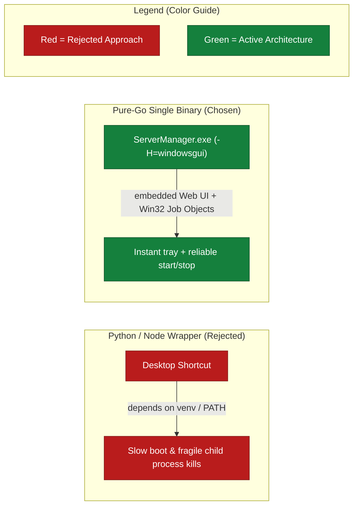
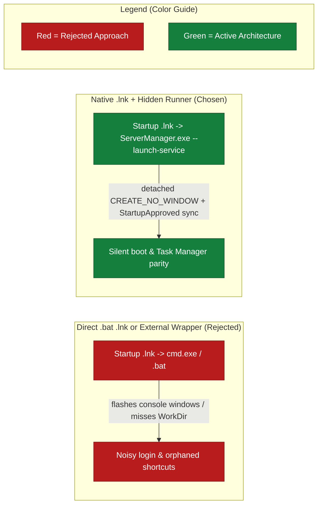

# Architectural Decisions, Pivots & Landmines (`DECISIONS_AND_TRAPS.md`)
> **1-Line Summary:** Records locked design choices for `Server Manager` (Go over Python, embedded Web UI over heavy frontend build, CLIProxyAPI auto-start) and non-obvious Windows engineering landmines.

## 1. Architectural Decisions & Pivot History

### [DECISION: Go-Single-Binary-Over-Python-Venv] | Aliases: Delta 1, Bravo 1, Go vs Python, portable exe
> **1-Line Summary:** Chose Go 1.24+ with an embedded vanilla Web UI over Python + FastAPI so the launcher compiles to a single portable Windows `.exe` with native tray and Job Object process control.
* **Decision Maker:** `[DECIDED BY: HUMAN (Delta 1)]`
* **Original User Intention:** Launch and manage scattered `.bat`/`.ps1` web servers from one fast GUI and Desktop shortcut without maintaining another Python venv or `node_modules` folder.
* **Options Considered:**
  * **Option A (Rejected):** Python local web server (requires `.venv`/PATH resolution from a Desktop shortcut and lacks zero-dependency native Win32 tray + Job Object bindings).
  * **Option B (Chosen):** Go backend (`ServerManager.exe` `-H=windowsgui` + `server-manager.exe` CLI) embedding a lightweight M3 HTML/CSS/ES-module frontend via `//go:embed`.
* **Plain-English Summary of Pivot:** One tiny Go binary starts instantaneously from a Desktop shortcut, puts a crisp custom icon in the Windows System Tray, manages child `.bat` trees cleanly, and keeps the repo bloat-free.
* **Visual Pivot Map (What Failed vs. What Works):**

* **Code Anchors (Grep Targets):**
  * `cmd/ServerManager/main.go` -> `main`
  * `internal/webui/embed.go` -> `FileServer`

### [DECISION: Auto-Start-CLIProxyAPI-And-Cache-Reports] | Aliases: Delta 4, CLIProxyAPI, Antigravity quota
> **1-Line Summary:** Auto-starts `~/.cli-proxy-api/start-cliproxy-hidden.vbs` when `:8317` is offline during AI requests, rotates across `/v1/models` on 429 cooldowns, and caches AI reports by script SHA-256.
* **Decision Maker:** `[DECIDED BY: HUMAN (Delta 4)]`
* **Original User Intention:** Clicking Options or Add with AI should reliably return an AI report even when `CLIProxyAPI` wasn't started manually beforehand, without wasting Antigravity quota on repeated clicks.
* **Options Considered:**
  * **Option A (Rejected):** Hardcoding one model name and failing immediately whenever `:8317` is not running.
  * **Option B (Chosen):** Probe `:8317`, launch `start-cliproxy-hidden.vbs` on demand when enabled, query `/v1/models`, try candidate models with 429 fallback, and cache results locally in `ai-cache.json`.
* **Code Anchors (Grep Targets):**
  * `internal/aiproxy/client.go` -> `EnsureRunning`, `GenerateReport`

### [DECISION: Windows-Startup-Folder-Lnk-And-Hidden-Runner] | Aliases: Alpha 1, Bravo 1, Bravo 6, StartupApproved, emersion/go-autostart
> **1-Line Summary:** Extended Server Manager's native `.lnk` helper with `ServerManager.exe --launch-service` and `StartupApproved` registry inspection instead of adding `go-autostart` or using Registry `Run` keys.
* **Decision Maker:** `[DECIDED BY: HUMAN (Alpha 1 / Bravo 1 / Bravo 4-6)]`
* **Original User Intention:** Toggle Windows Startup on and off for any service (discovered, custom-added, or Server Manager itself) without terminal popups on login, external dependencies, or breaking existing shortcuts like `CLIProxyAPI.lnk`.
* **Options Considered:**
  * **Option A (Rejected):** `emersion/go-autostart` (`go-ole`) or Registry `HKCU\...\Run` — `go-autostart` pulls in external COM wrappers without native `WorkingDirectory`/hidden-window fields, while Registry `Run` hides entries from the Windows Startup folder and lacks working-directory metadata.
  * **Option B (Chosen):** Extend `internal/startup` over Windows Startup folder `.lnk` files, preferring existing `*-hidden.vbs` launchers or `ServerManager.exe --launch-service <id>` (`-H=windowsgui` + `CREATE_NO_WINDOW`), paired with `HKCU\...\StartupApproved\StartupFolder` audit via `golang.org/x/sys/windows/registry`.
* **Visual Pivot Map (What Failed vs. What Works):**

* **Code Anchors (Grep Targets):**
  * `internal/startup/startup.go` -> `SetServiceEnabled`, `SetSelfEnabled`
  * `internal/supervisor/manager.go` -> `LaunchDetached`

### [DECISION: Multi-Source-Service-Icons-And-NonDestructive-Grouping] | Aliases: Bravo 1, Bravo 3, Charlie 1, script selector, service icons
> **1-Line Summary:** Grouped multi-script launchers in Server Manager with a persistent selector and manual Split/Group instead of rewriting external `.bat` files, paired with multi-source local/exe/cached-favicon icons and M3 monograms.
* **Decision Maker:** `[DECIDED BY: HUMAN (Bravo 1/3/5/6, Charlie 1/4/5)]`
* **Original User Intention:** Fix search icon text overlap, add clean per-app icons on service cards when available, and combine duplicate/variant `.bat` entries for the same server (including Electron desktop wrappers like `AV Manager`'s `PhysicsLab.bat`, while surfacing missing `node_modules` clearly) without modifying external repo scripts.
* **Options Considered:**
  * **Option A (Rejected):** Rewriting external project `.bat` files on disk into merged scripts, or strictly grouping everything by top-level folder and scanning arbitrary `.png`/`.jpg` files.
  * **Option B (Chosen):** Non-destructive `discovery.applyGroupingAndDeduplication` (grouping by shared ports, compatible working-dir/server family, project Electron wrapper pairing, or command signature while hiding pure `.bat`/`.ps1` wrapper twins and persisting user `PreferredScripts`/`UngroupedIDs`/`ManualGroups`), paired with strict filename-targeted icon discovery, Win32 `.exe` extraction, cached loopback favicon probing, custom icon overrides, and letter monograms.
* **Code Anchors (Grep Targets):**
  * `internal/discovery/grouping.go` -> `applyGroupingAndDeduplication`, `shouldAutoGroup`, `isElectronWrapperPair`
  * `internal/icons/icons.go` -> `Manager`, `Refresh`, `ProbeWebFaviconAsync`
  * `internal/webui/static/app.js` -> `buildServiceCards`, `renderIconTile`

### [DECISION: Disk-Static-HotReload-And-Dual-Shortcuts] | Aliases: Alpha 1, Bravo 1, Bravo 4, Bravo 5, hot reload, start-dev
> **1-Line Summary:** Added pure-Go mtime-polled disk Web UI serving (`ui-reload` SSE) plus a hidden `go run` dev shortcut alongside `ServerManager.exe` instead of bundling `air` or restarting managed servers on CSS/JS edits.
* **Decision Maker:** `[DECIDED BY: HUMAN (Alpha 1, Bravo 1, Bravo 4, Bravo 5)]`
* **Original User Intention:** Avoid rebuilding `.exe` binaries after UI or small fixes and launch Server Manager as a hot-loaded Web GUI from the Desktop.
* **Options Considered:**
  * **Option A (Rejected):** Installing an external Go file watcher (`air`) that restarts the Go backend process on any edit (which would interrupt active managed child processes) or overwriting the production `.exe` Desktop shortcut.
  * **Option B (Chosen):** Auto-resolve `internal/webui/static` via `config.ResolveRepoDir`, serve disk assets with `Cache-Control: no-store` and pure-Go `450ms` mtime polling emitting `ui-reload` over SSE, and add a second `Server Manager (Hot-Reload).lnk` Desktop shortcut invoking `start-dev-hidden.vbs` -> `start-dev.bat` (builds/runs `ServerManager-dev.exe` from latest source without locking log files, or focuses the Web UI immediately if already running).
* **Code Anchors (Grep Targets):**
  * `internal/server/server.go` -> `resolveLiveWebUIDir`, `watchLiveWebUIDir`
  * `internal/tray/tray_windows.go` -> `InstallDevDesktopShortcut`
  * `start-dev.bat` / `start-dev-hidden.vbs`

---

## 2. Do-Not-Touch Engineering Landmines (Traps)

### [TRAP: Loopback-Binding-And-CSRF-Guard] | Aliases: 0.0.0.0, Origin header, Host header, bearer token
> **1-Line Summary:** NEVER bind the server outside `127.0.0.1` or bypass `Host`, `Origin`, and Bearer auth checks because `Server Manager` executes arbitrary local launcher scripts.
* **Strict Rule:** **NEVER** change `DefaultBindHost` away from `127.0.0.1` or allow arbitrary `Origin` headers on control routes (`/api/v1/*`, `/api/v1/shutdown`).
* **Why This Trap Exists (Plain English):** Any web page open in the user's browser could otherwise trigger local `.bat`/`.ps1` execution via CSRF or DNS rebinding.
* **Protected Code Anchors (Grep Targets):**
  * `internal/security/security.go` -> `IsLoopbackBind`, `ValidateLoopbackHost`, `ValidateOrigin`
  * `internal/server/server.go` -> `withGuard`

### [TRAP: Bat-Child-Orphan-Process-Tree] | Aliases: pause, taskkill, orphan uvicorn, cmd.exe
> **1-Line Summary:** NEVER rely only on `cmd.Process.Kill()` when stopping Windows `.bat`/`.ps1` launchers, and never pass an open interactive stdin that stalls on trailing `pause`.
* **Strict Rule:** **NEVER** remove Windows Job Object assignment or `taskkill /T /F` process-tree cleanup, and keep child stdin closed (`nil` / EOF) when running `.bat` files.
* **Why This Trap Exists (Plain English):** Many project `.bat` files launch `cmd.exe -> python/uvicorn/node` and end with `pause`. Killing only `cmd.exe` leaves the child server running and holding the port.
* **Protected Code Anchors (Grep Targets):**
  * `internal/supervisor/manager.go` -> `Start`, `Stop`, `terminatePIDTree`
  * `internal/security/job_windows.go` -> `JobSupervisor`

### [TRAP: CLIProxyAPI-Dynamic-Model-And-Redaction] | Aliases: quota 429, secrets leak, antigravity model, auth_unavailable
> **1-Line Summary:** NEVER hardcode a single model ID, skip the cold-start OAuth warmup grace/retry, or send raw `.env` / API tokens to `CLIProxyAPI`.
* **Strict Rule:** **NEVER** remove `security.RedactSecrets` before sending script/README snippets to `CLIProxyAPI`, and always query `/v1/models` (filtering out image/embedding models) with cold-start `auth_unavailable` warmup retry plus fallback across returned models.
* **Why This Trap Exists (Plain English):** `CLIProxyAPI` opens port `8317` ~1.5 seconds before finishing its cold-start OAuth token refresh (causing transient `503 auth_unavailable` if called immediately), Antigravity accounts experience per-model `429` quota cooldowns, and project files can contain secrets.
* **Protected Code Anchors (Grep Targets):**
  * `internal/aiproxy/client.go` -> `EnsureRunning`, `pickCandidateModels`, `chatJSONWithFallback`
  * `internal/security/security.go` -> `RedactSecrets`

### [TRAP: Unbounded-Media-And-VirtualDrive-Crawl] | Aliases: Cryptomator D:, Images, Comics, node_modules, hang
> **1-Line Summary:** NEVER enable recursive scanning without depth caps and media/dependency skip-lists, especially on Cryptomator virtual drive `D:`.
* **Strict Rule:** **NEVER** remove directory skip-lists (`node_modules`, `.venv`, `.git`, `Images`, `Comics`, `SteamLibrary`, `Calibre`, `Books`, `Nippon`) or the `MaxDepth` guard in `discovery.Scan`.
* **Why This Trap Exists (Plain English):** Unbounded `WalkDir` across `D:\Images` or `E:\Books` stalls for minutes over virtual WinFsp / large media trees.
* **Protected Code Anchors (Grep Targets):**
  * `internal/discovery/scanner.go` -> `shouldSkipDir`, `Scan`

### [TRAP: UTF8-No-BOM-Atomic-Writes] | Aliases: BOM, corrupted json, ecosystem-registry
> **1-Line Summary:** NEVER write JSON configs (`config.json`, `ecosystem-registry.json`, `ai-cache.json`) with a UTF-8 BOM or non-atomic `os.WriteFile`.
* **Strict Rule:** **NEVER** bypass `config.WriteJSONAtomic` when saving configs or updating `ecosystem-registry.json`.
* **Why This Trap Exists (Plain English):** PowerShell/Node/Python tools choke on unexpected BOM bytes or partial writes during crashes.
* **Protected Code Anchors (Grep Targets):**
  * `internal/config/config.go` -> `WriteAtomicNoBOM`, `WriteJSONAtomic`

### [TRAP: Startup-Lnk-PowerShell-Single-Array-And-Console-Flash] | Aliases: ConvertTo-Json, CREATE_NO_WINDOW, StartupApproved, sig cache
> **1-Line Summary:** NEVER assume PowerShell `ConvertTo-Json` emits a JSON array for 1 `.lnk` file, never spawn PowerShell on every SSE poll, and never omit `CREATE_NO_WINDOW` in `--launch-service`.
* **Strict Rule:** **NEVER** parse `ConvertTo-Json` output as array-only (`parseShortcutListJSON` must accept both `{...}` and `[{...}]`), **NEVER** bypass `computeDirSignature` caching in `startup.Manager.snapshotShortcuts` (otherwise SSE status events spawn PowerShell repeatedly), and **NEVER** start `.bat`/`.ps1` boot shortcuts directly without `-H=windowsgui` (`ServerManager.exe --launch-service`) or a `wscript.exe` `*-hidden.vbs` wrapper.
* **Why This Trap Exists (Plain English):** Windows PowerShell 5.1 unwraps single-element pipeline results into a JSON object instead of `[item]`, causing silent discovery misses when only one `.lnk` exists; spawning PowerShell on every UI refresh burns CPU; and direct `.bat` `.lnk` files pop up visible console windows at Windows login.
* **Protected Code Anchors (Grep Targets):**
  * `internal/startup/startup.go` -> `snapshotShortcuts`, `computeDirSignature`
  * `internal/startup/startup_windows.go` -> `parseShortcutListJSON`, `IsStartupApproved`
  * `internal/supervisor/manager.go` -> `LaunchDetached`

### [TRAP: Service-Icon-CSP-SameOrigin-And-Media-Noise] | Aliases: service-icons, Sec-Fetch-Site, attachment images, search input specificity
> **1-Line Summary:** NEVER relax same-origin guards on `/service-icons/`, NEVER broaden icon scanning into arbitrary media subfolders (`catalog/attachments`, `characters`), and NEVER let generic `input[type="search"]` override `.search-wrap` left padding.
* **Strict Rule:** Keep `Sec-Fetch-Site: cross-site` blocking + `Cross-Origin-Resource-Policy: same-origin` + `default-src 'none'` headers on `serveServiceIcon`, restrict local icon matching to explicit icon/logo/favicon filenames (`strictIconFileRe`), and keep `.search-wrap input[type="search"]` at higher specificity than the modal form rule in `app.css`.
* **Why This Trap Exists (Plain English):** Media projects (`Doujin Manager`, `SillyTavern`) contain hundreds of attachment/character images that look like app icons to naive scanners, cross-origin `` requests do not carry Bearer headers, and equal CSS specificity caused `input[type="search"]` to crush search-box padding over the magnifying glass icon.
* **Protected Code Anchors (Grep Targets):**
  * `internal/icons/icons.go` -> `findProjectIconFile`, `strictIconFileRe`
  * `internal/server/server.go` -> `serveServiceIcon`
  * `internal/webui/static/app.css` -> `.search-wrap input[type="search"]`
