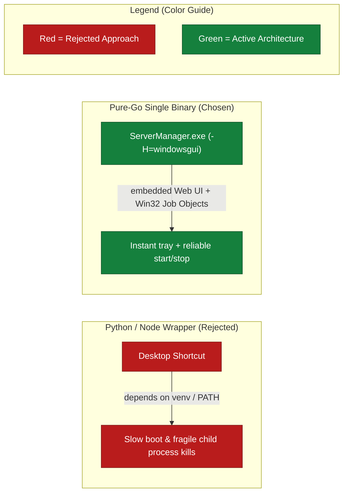

# Architectural Decisions, Pivots & Landmines (`DECISIONS_AND_TRAPS.md`)
> **1-Line Summary:** Records locked design choices for `Server Manager` (Go over Python, embedded Web UI over heavy frontend build, CLIProxyAPI auto-start) and non-obvious Windows engineering landmines.

## 1. Architectural Decisions & Pivot History

### [DECISION: Go-Single-Binary-Over-Python-Venv] | Aliases: Delta 1, Bravo 1, Go vs Python, portable exe
> **1-Line Summary:** Chose Go 1.24+ with an embedded vanilla Web UI over Python + FastAPI so the launcher compiles to a single portable Windows `.exe` with native tray and Job Object process control.
* **Decision Maker:** `[DECIDED BY: HUMAN (Delta 1)]`
* **Original User Intention:** Launch and manage scattered `.bat`/`.ps1` web servers from one fast GUI and Desktop shortcut without maintaining another Python venv or `node_modules` folder.
* **Options Considered:**
  * **Option A (Rejected):** Python local web server (requires `.venv`/PATH resolution from a Desktop shortcut and lacks zero-dependency native Win32 tray + Job Object bindings).
  * **Option B (Chosen):** Go backend (`ServerManager.exe` `-H=windowsgui` + `server-manager.exe` CLI) embedding a lightweight M3 HTML/CSS/ES-module frontend via `//go:embed`.
* **Plain-English Summary of Pivot:** One tiny Go binary starts instantaneously from a Desktop shortcut, puts a crisp custom icon in the Windows System Tray, manages child `.bat` trees cleanly, and keeps the repo bloat-free.
* **Visual Pivot Map (What Failed vs. What Works):**

* **Code Anchors (Grep Targets):**
  * `cmd/ServerManager/main.go` -> `main`
  * `internal/webui/embed.go` -> `FileServer`

### [DECISION: Auto-Start-CLIProxyAPI-And-Cache-Reports] | Aliases: Delta 4, CLIProxyAPI, Antigravity quota
> **1-Line Summary:** Auto-starts `~/.cli-proxy-api/start-cliproxy-hidden.vbs` when `:8317` is offline during AI requests, rotates across `/v1/models` on 429 cooldowns, and caches AI reports by script SHA-256.
* **Decision Maker:** `[DECIDED BY: HUMAN (Delta 4)]`
* **Original User Intention:** Clicking Options or Add with AI should reliably return an AI report even when `CLIProxyAPI` wasn't started manually beforehand, without wasting Antigravity quota on repeated clicks.
* **Options Considered:**
  * **Option A (Rejected):** Hardcoding one model name and failing immediately whenever `:8317` is not running.
  * **Option B (Chosen):** Probe `:8317`, launch `start-cliproxy-hidden.vbs` on demand when enabled, query `/v1/models`, try candidate models with 429 fallback, and cache results locally in `ai-cache.json`.
* **Code Anchors (Grep Targets):**
  * `internal/aiproxy/client.go` -> `EnsureRunning`, `GenerateReport`

---

## 2. Do-Not-Touch Engineering Landmines (Traps)

### [TRAP: Loopback-Binding-And-CSRF-Guard] | Aliases: 0.0.0.0, Origin header, Host header, bearer token
> **1-Line Summary:** NEVER bind the server outside `127.0.0.1` or bypass `Host`, `Origin`, and Bearer auth checks because `Server Manager` executes arbitrary local launcher scripts.
* **Strict Rule:** **NEVER** change `DefaultBindHost` away from `127.0.0.1` or allow arbitrary `Origin` headers on control routes (`/api/v1/*`, `/api/v1/shutdown`).
* **Why This Trap Exists (Plain English):** Any web page open in the user's browser could otherwise trigger local `.bat`/`.ps1` execution via CSRF or DNS rebinding.
* **Protected Code Anchors (Grep Targets):**
  * `internal/security/security.go` -> `IsLoopbackBind`, `ValidateLoopbackHost`, `ValidateOrigin`
  * `internal/server/server.go` -> `withGuard`

### [TRAP: Bat-Child-Orphan-Process-Tree] | Aliases: pause, taskkill, orphan uvicorn, cmd.exe
> **1-Line Summary:** NEVER rely only on `cmd.Process.Kill()` when stopping Windows `.bat`/`.ps1` launchers, and never pass an open interactive stdin that stalls on trailing `pause`.
* **Strict Rule:** **NEVER** remove Windows Job Object assignment or `taskkill /T /F` process-tree cleanup, and keep child stdin closed (`nil` / EOF) when running `.bat` files.
* **Why This Trap Exists (Plain English):** Many project `.bat` files launch `cmd.exe -> python/uvicorn/node` and end with `pause`. Killing only `cmd.exe` leaves the child server running and holding the port.
* **Protected Code Anchors (Grep Targets):**
  * `internal/supervisor/manager.go` -> `Start`, `Stop`, `terminatePIDTree`
  * `internal/security/job_windows.go` -> `JobSupervisor`

### [TRAP: CLIProxyAPI-Dynamic-Model-And-Redaction] | Aliases: quota 429, secrets leak, antigravity model, auth_unavailable
> **1-Line Summary:** NEVER hardcode a single model ID, skip the cold-start OAuth warmup grace/retry, or send raw `.env` / API tokens to `CLIProxyAPI`.
* **Strict Rule:** **NEVER** remove `security.RedactSecrets` before sending script/README snippets to `CLIProxyAPI`, and always query `/v1/models` (filtering out image/embedding models) with cold-start `auth_unavailable` warmup retry plus fallback across returned models.
* **Why This Trap Exists (Plain English):** `CLIProxyAPI` opens port `8317` ~1.5 seconds before finishing its cold-start OAuth token refresh (causing transient `503 auth_unavailable` if called immediately), Antigravity accounts experience per-model `429` quota cooldowns, and project files can contain secrets.
* **Protected Code Anchors (Grep Targets):**
  * `internal/aiproxy/client.go` -> `EnsureRunning`, `pickCandidateModels`, `chatJSONWithFallback`
  * `internal/security/security.go` -> `RedactSecrets`

### [TRAP: Unbounded-Media-And-VirtualDrive-Crawl] | Aliases: Cryptomator D:, Images, Comics, node_modules, hang
> **1-Line Summary:** NEVER enable recursive scanning without depth caps and media/dependency skip-lists, especially on Cryptomator virtual drive `D:`.
* **Strict Rule:** **NEVER** remove directory skip-lists (`node_modules`, `.venv`, `.git`, `Images`, `Comics`, `SteamLibrary`, `Calibre`, `Books`, `Nippon`) or the `MaxDepth` guard in `discovery.Scan`.
* **Why This Trap Exists (Plain English):** Unbounded `WalkDir` across `D:\Images` or `E:\Books` stalls for minutes over virtual WinFsp / large media trees.
* **Protected Code Anchors (Grep Targets):**
  * `internal/discovery/scanner.go` -> `shouldSkipDir`, `Scan`

### [TRAP: UTF8-No-BOM-Atomic-Writes] | Aliases: BOM, corrupted json, ecosystem-registry
> **1-Line Summary:** NEVER write JSON configs (`config.json`, `ecosystem-registry.json`, `ai-cache.json`) with a UTF-8 BOM or non-atomic `os.WriteFile`.
* **Strict Rule:** **NEVER** bypass `config.WriteJSONAtomic` when saving configs or updating `ecosystem-registry.json`.
* **Why This Trap Exists (Plain English):** PowerShell/Node/Python tools choke on unexpected BOM bytes or partial writes during crashes.
* **Protected Code Anchors (Grep Targets):**
  * `internal/config/config.go` -> `WriteAtomicNoBOM`, `WriteJSONAtomic`
